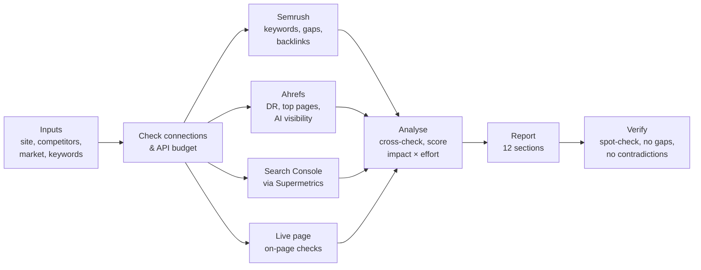

# SEO Competitor Gap Report: a Claude Skill

> Turn Claude into an SEO analyst that benchmarks your website against 5–6 competitors, using **live data from Semrush, Ahrefs and Google Search Console**, and produces a prioritised, decision-ready report.

    

---

## Why this exists

Most AI-generated SEO audits rely on a single tool's estimates, leave data gaps, and list recommendations without priorities. This skill fixes that:

| Typical AI audit | This skill |
|---|---|
| One data source | **Semrush + Ahrefs cross-checked**; disagreements shown, not hidden |
| Estimated traffic for your own site | **Real Search Console clicks, impressions and positions** |
| One competitor | **5–6 competitors**, so patterns stand out |
| Flat list of ideas | **Impact × Effort scoring** → P1 quick wins to P4 park |
| Blank cells, internal contradictions | **Verification step**: spot-checks, no empty cells, consistency pass |
| Ignores AI search | **AI visibility** (ChatGPT, Perplexity, AI Overviews) via Ahrefs Brand Radar |

## What the report covers

1. Executive summary and top 5 opportunities
2. Competitor scorecard (7 sites side by side)
3. Your real performance (Search Console)
4. Keyword gap, including consensus gaps where 3+ competitors rank and you don't
5. Content gap
6. SERP analysis
7. On-page comparison
8. Backlink gap and link-building targets
9. AI search visibility
10. Opportunity matrix (impact × effort)
11. 90-day action plan
12. Methodology and sources

See [`docs/workflow.md`](docs/workflow.md) for the full flow and [`examples/`](examples/) for sample prompts and an illustrative scorecard.

## How it works



## Requirements

- **Claude** with skills enabled (Claude apps, Claude Code or the API)
- Connectors (MCP):
  - [Semrush](https://www.semrush.com/): a plan with API units
  - [Ahrefs](https://ahrefs.com/): a plan with API access
  - [Supermetrics](https://supermetrics.com/) with Google Search Console authenticated (optional, but strongly recommended)

## Install

**Claude apps (web, desktop or mobile)**
1. Download or clone this repo.
2. Zip `SKILL.md` and the `references` folder together (or download the release zip).
3. In Claude, go to **Settings → Capabilities → Skills → Upload skill** and upload the zip.

**Claude Code**
```bash
git clone https://github.com/rutujamarketing-rue/seo-competitor-gap-report.git
mkdir -p ~/.claude/skills/seo-competitor-gap-report
cp -r seo-competitor-gap-report/SKILL.md seo-competitor-gap-report/references ~/.claude/skills/seo-competitor-gap-report/
```

## Usage

```
Run the SEO competitor gap report for example.com vs competitor-a.com,
competitor-b.com, competitor-c.com, competitor-d.com, competitor-e.com.
Focus: "go-to-market strategy consulting". Market: US.
```

More prompts are in [`examples/sample-prompts.md`](examples/sample-prompts.md).

## Cost

One full run with 7 domains uses roughly:
- **Semrush:** ~25,000–30,000 API units
- **Ahrefs:** ~5,000–20,000 API units
- **Claude:** a heavy task, so run it in a fresh conversation

The details are in [`docs/cost-guide.md`](docs/cost-guide.md).

## Repo structure

```
seo-competitor-gap-report/
├── SKILL.md                    # the skill Claude loads
├── references/
│   ├── data-pull-map.md        # which tool/report answers what, and its cost
│   ├── prioritisation.md       # impact × effort scoring
│   └── report-template.md      # 12-section report structure
├── docs/
│   ├── workflow.md
│   └── cost-guide.md
├── examples/
│   ├── sample-prompts.md
│   └── sample-scorecard.md     # illustrative, fictional data
├── CHANGELOG.md
└── LICENSE
```

## Roadmap

- [ ] Technical SEO module (Semrush Site Audit / Ahrefs Site Audit)
- [ ] Multi-market mode (compare the same competitors across US, UAE and EU)
- [ ] Monthly re-run with change tracking
- [ ] GA4 conversion layer

## Author

**Rutuja**, growth and performance marketer (SEO, paid, content, B2B link building).
Connect on [LinkedIn](https://www.linkedin.com/in/rutuja-ghodke/) · GitHub: [@rutujamarketing-rue](https://github.com/rutujamarketing-rue)

Contributions and feedback are welcome. Open an issue or a PR.

## License

[MIT](LICENSE)

*Not affiliated with Anthropic, Semrush, Ahrefs or Supermetrics. Tool names are trademarks of their owners.*
