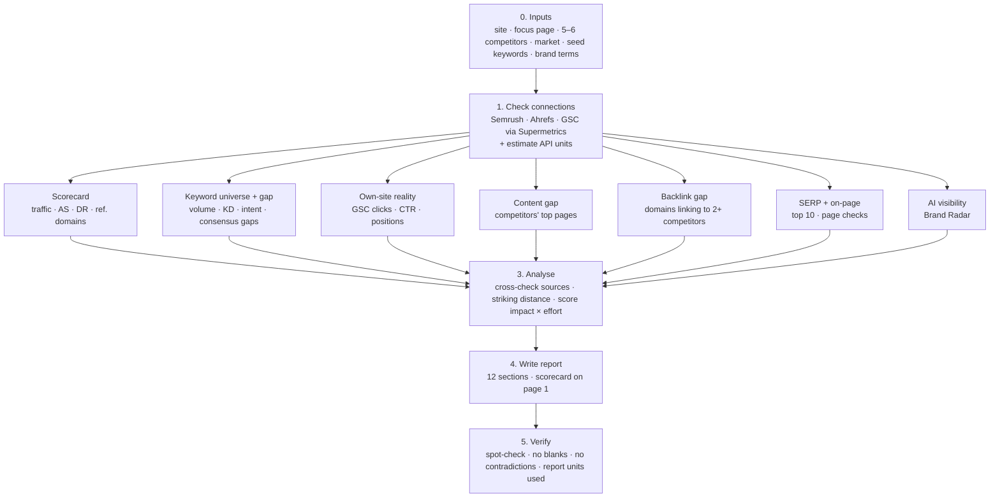

# Workflow

## Step-by-step

| Step | What happens | Output |
|---|---|---|
| 0. Inputs | Collect site, competitors, market, keywords, brand terms | Brief |
| 1. Connections | Confirm each tool works; estimate cost | Go / no-go |
| 2. Data pulls | Run reports per `references/data-pull-map.md` | CSVs |
| 3. Analysis | Cross-check, find gaps, score opportunities | Opportunity matrix |
| 4. Report | Fill `references/report-template.md` | Shareable doc |
| 5. Verify | Quality checks | Final report + units used |

## Design decisions

- **Focus on one topic per run.** Whole-site comparisons get shallow; one commercial topic gives actionable depth.
- **Two sources per headline metric.** Third-party tools estimate. Showing both values builds trust with stakeholders.
- **First-party data wins.** Search Console overrides third-party estimates for your own site.
- **Consensus gaps over single-competitor gaps.** If three or more competitors rank for something, the demand is proven.
